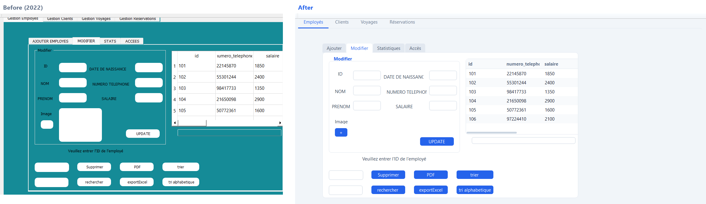
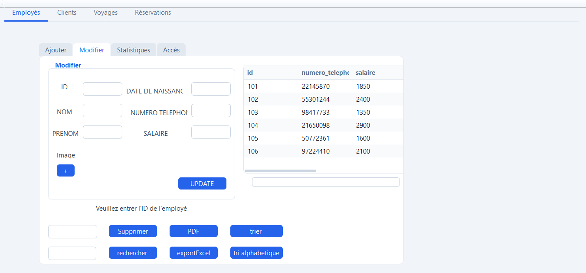
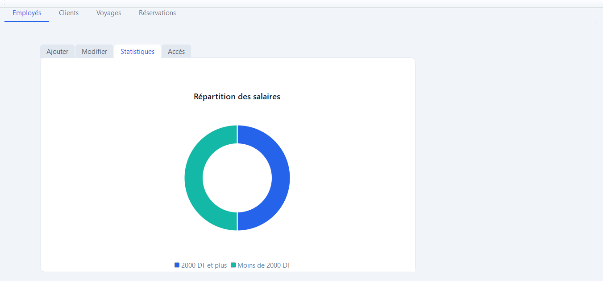
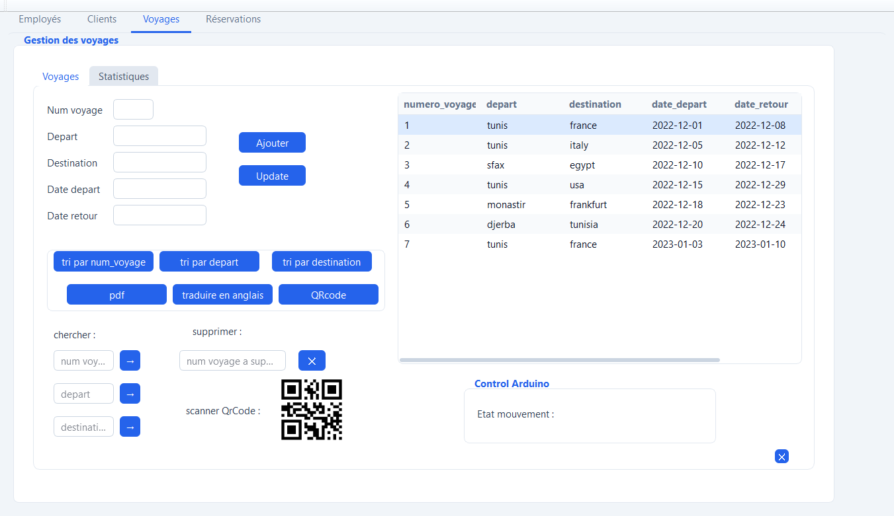
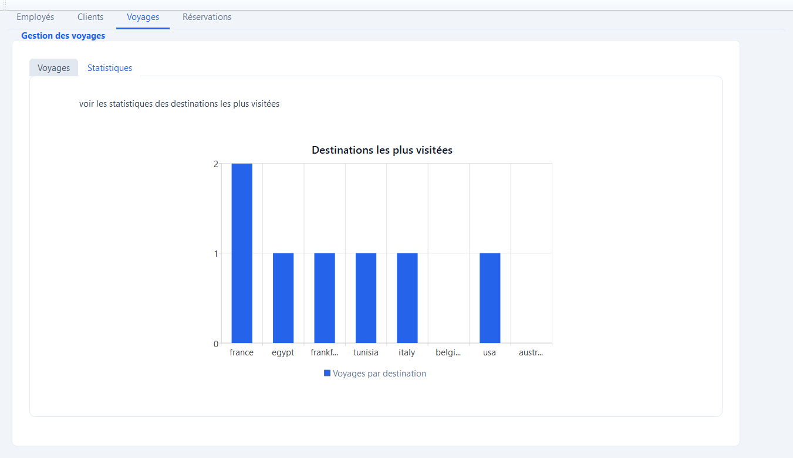
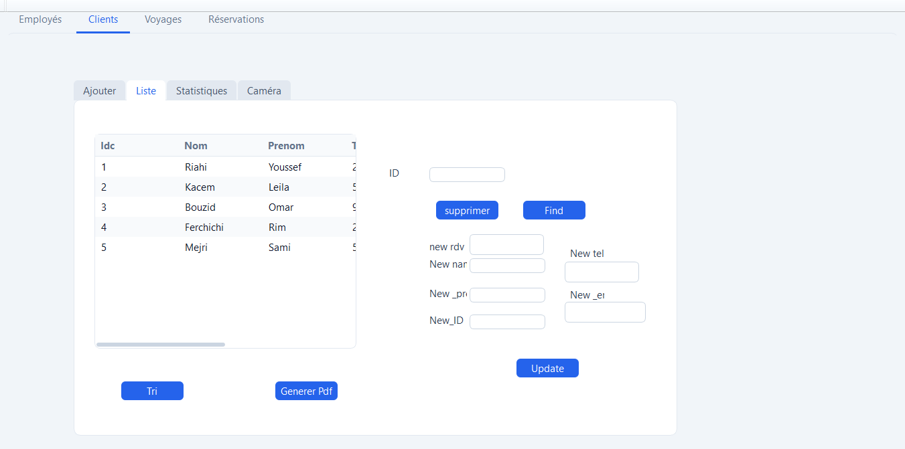
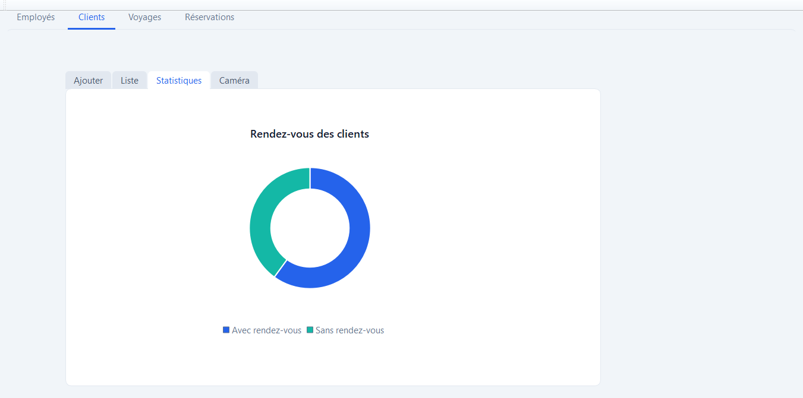
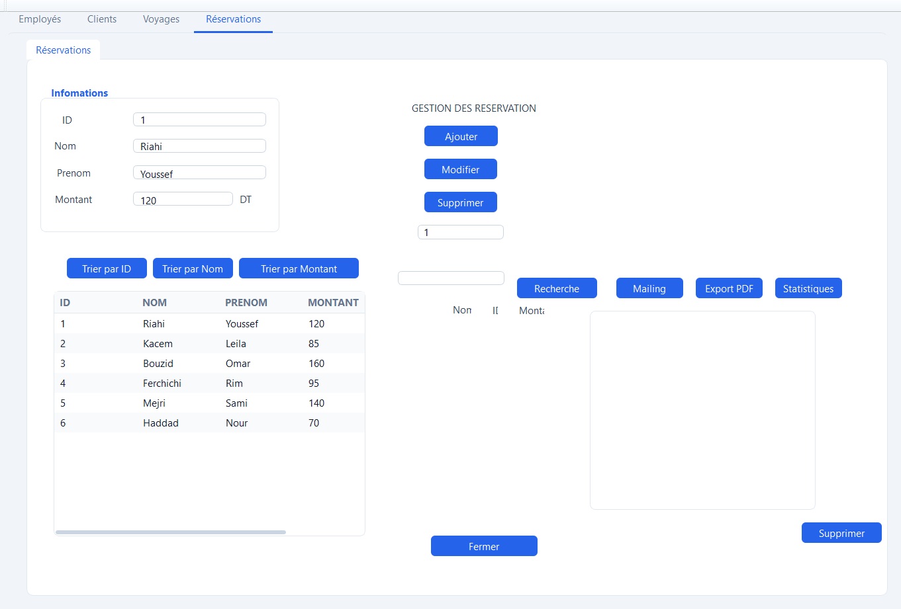
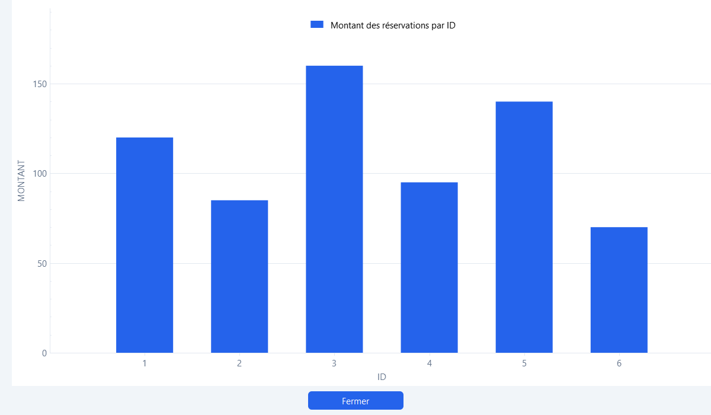

# Haya Trip

A Qt / C++ desktop back office for a travel agency: **employees, clients, trips and reservations** in one window, with charts, PDF and Excel exports, QR codes for trips, email to clients, and an **Arduino** link over a serial port.

Second-year team project (class 2A28) at **ESPRIT**, autumn 2022. My parts: the Employees module, the Arduino link and integrating the team's four modules into one application. In 2026 I modernised the interface and cleaned the project up for publication.



## Screenshots

| | |
|---|---|
|  |  |
|  |  |
|  |  |
|  |  |

All data shown is fictional.

## Features

- Employees, clients, trips and reservations: add, edit, delete, search and sort
- Salary and appointment donut charts (Qt Charts), destinations and reservation-amount bar charts
- PDF exports, Excel export of the employee table
- QR code generated for the selected trip
- Email to a client over SMTP/SSL
- Reservation history log
- Arduino access control over a serial port (Accept / Refuse send `1` / `0`)

## What changed in the 2026 refresh

- One application theme (`resources/style.qss` + `theme.cpp`) replacing 120+ inline stylesheets and one-off fonts
- Consistent chart styling; fixed a client chart that counted every client as "without appointment"
- QR code now appears on the trips screen (it was drawn on another tab)
- Arduino status shown on the access tab instead of overwriting a trips label
- Clear tab names, text on buttons whose icon files were missing, empty tab removed
- Runs anywhere: SQLite demo database by default, Oracle optional; no credentials or personal paths in the source; PDF exports ask where to save
- Removed duplicated and unused files

## Build and run

Requirements: Qt 5.9+ (MinGW or MSVC) with Charts, SerialPort, Multimedia, Svg and ActiveQt (Windows, for the Excel export).

```bash
qmake HayaTrip.pro
make            # mingw32-make on Windows
```

By default the app creates a local SQLite database with demo data. To use the original Oracle XE database through ODBC:

| Variable | Purpose |
|---|---|
| `HAYATRIP_DB=oracle` | use Oracle instead of SQLite |
| `HAYATRIP_ODBC_DSN` | ODBC data source (default `Source_projet2A`) |
| `HAYATRIP_DB_USER`, `HAYATRIP_DB_PASSWORD` | database login |
| `HAYATRIP_SMTP_USER`, `HAYATRIP_SMTP_PASSWORD` | prefill the mailing dialog |
| `HAYATRIP_SQLITE_PATH` | custom SQLite file |

`HayaTrip --capture <folder>` saves a screenshot of every tab and quits.

Known limits: the reservation search uses Oracle's `regexp_like`, so it only works on Oracle; some queries still build SQL by string concatenation.

## Third-party code

- [QCustomPlot](https://www.qcustomplot.com/) (GPL v3) — `qcustomplot.cpp/.h`
- [QR Code generator library](https://www.nayuki.io/page/qr-code-generator-library) by Project Nayuki (MIT) — `qrcode.cpp/.h`
